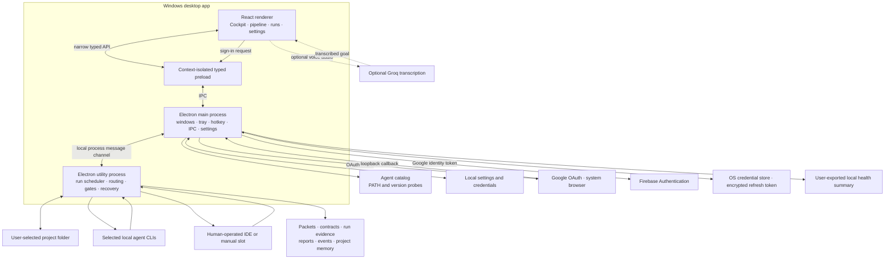
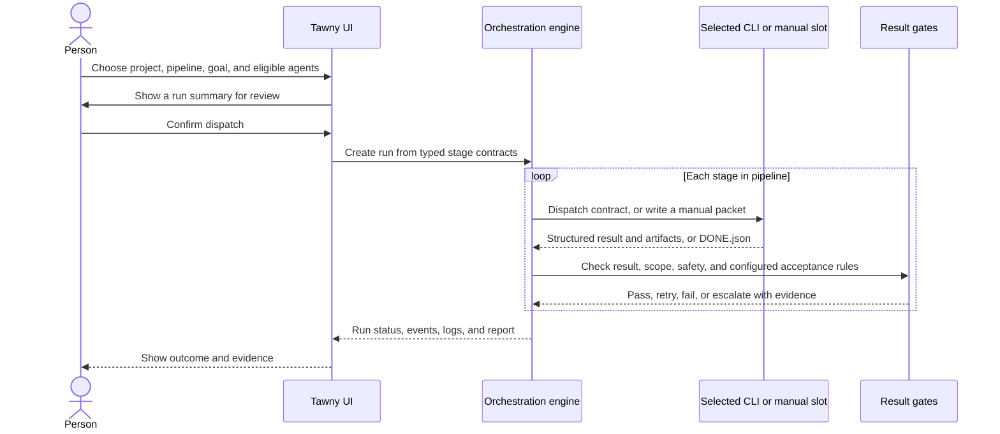

# Tawny Orch

> A Windows desktop orchestration prototype for routing work through locally installed coding-agent CLIs, collecting their outputs, and checking each handoff.

Tawny Orch is built with Electron, React, and TypeScript. The orchestration engine runs in an Electron utility process, separate from the UI renderer. Project files, run artifacts, packets, and logs are kept locally. This checkout does **not** include the planned phone app, remote relay, account service, or cloud control plane.

## At a glance

| | Current behavior |
| --- | --- |
| Platform | Windows desktop app; `pnpm dev` opens Electron |
| Workflow | Staged project pipeline with agent routing, handoff artifacts, gates, retries, and escalation |
| Agent access | Selected local CLIs plus a human operated manual packet slot |
| Agent access | No Tawny free-tier confirmation gate; selected CLIs use their saved provider/model configuration |
| Storage | Local project and app data; account refresh tokens use OS-backed encrypted storage |
| Mobile | Not implemented; no phone pairing or remote connection endpoint |

This is a substantial desktop prototype, not the full multi-phase product in the architecture document. The status tables below record what the source supports today and what remains planned.

## Start the desktop app

### Requirements

- Windows 10 or 11
- Node.js and pnpm
- Git on `PATH` for Git-based workspace and verification features
- Install and sign in to the agent CLIs you plan to use; Tawny Orch does not install them

### Install and run

```powershell
pnpm install
pnpm dev
```

`pnpm dev` starts the Vite renderer and Electron shell. It should open a **desktop Electron window**; it is not a web server to open on a phone. In the app, attach a project folder in Cockpit, inspect and save its pipeline, choose detected agents by stage, enter a goal, and review the run before dispatch. Configure sign-in, provider, and local models in each agent CLI; Tawny does not override those settings or estimate provider charges.

New runs use the selected project folder as the execution workspace, so requested files and code changes appear there as the agents work. Tawny captures a pre-stage snapshot, checks allowed paths and secrets, and records stage evidence. Pipeline configuration and shared memory are stored under Tawny's app-data directory; manual-agent packets and run evidence are stored with the run. New runs therefore do not create a `.tawny-orch/` directory in the selected project. Existing legacy `.tawny-orch/` configuration and memory are read and migrated forward on the next save. Older runs that already have a recorded worktree continue to use that workspace. Use **Open selected project folder** on a new run to navigate to the exact folder agents use.

Typed goals work without a transcription provider. Optional voice capture requires a Groq API key, network access, microphone permission, and provider allowance. Voice audio is sent to Groq for transcription; it is not an offline path.

### Google account sign-in

The first launch requires a Google account configured through Firebase Authentication. Tawny opens Google in your system browser, returns through a temporary loopback callback protected by OAuth state and PKCE, then exchanges the Google identity token with Firebase. Google currently requires the Desktop OAuth client's generated secret in that exchange; because a desktop app is a public client, the value is extractable and is not a real server-side secret. The account refresh token remains in Electron's main process and is encrypted through the operating-system credential service; it is not placed in the Windows registry. If the OS keychain is unavailable, sign-in lasts for the current app session. See [Google authentication setup](docs/GOOGLE-AUTH-SETUP.md) for Firebase/Google Cloud setup and release build variables.

Tawny does not upload behavior analytics. Settings and the signed-out screen can export a user-initiated local diagnostic summary containing app/platform/auth/update health and grouped local event counts. It excludes email, project paths, prompts, raw logs and account tokens; the save dialog writes it only where you choose.

### Development checks

```powershell
pnpm typecheck
pnpm test
pnpm build
```

`pnpm test` covers contracts, detection, routing, adapters, persistence, IPC, and local Git workflows. Real Git workflow tests require Git on `PATH`. The desktop UI suite is opt-in/skipped by the default Vitest run, so a successful build or test run is not a substitute for opening the Electron app and inspecting the UI.

## Visual architecture



The utility process keeps orchestration separate from React rendering, but it still belongs to the Electron app. It is **not** a standalone service that stays alive after the desktop app exits. The preload exposes a narrow typed API; renderer Node integration is disabled and context isolation is enabled.

### Data and handoff flow



Agents do not send arbitrary shell commands directly to each other. The engine validates the structured final response, persists the result outside the project, records a verified packet, and embeds the packet contents into the next stage's contract. This lets the next agent receive research/plan findings and gate evidence directly, without needing access to Tawny's private app-data paths. Manual stages produce a Markdown packet for a person to use in an IDE or other tool; the person returns a `DONE.json` sentinel and evidence. The engine decides whether a stage can advance after applying its gates.

### Where requested files go

For new Git projects, execute and test stages work in the selected folder by default. When a goal explicitly asks for a deliverable (for example, “create `plan.md`” or “make a plan + architecture”), Tawny records those project-relative paths in the contract and verifies each requested file changed during the execute stage. Existing requested files may be updated in place; they are not copied or replaced by a second file operation. The run report lists requested, present, and blocked outputs. Current direct mode makes all code changes in the selected checkout, so review the run report and Git diff before keeping or reverting them.

The run view streams headless CLI output while an agent is running. When Codex, OpenCode, Gemini CLI, or Claude Code returns a structured session ID, **Resume agent session** opens that saved conversation in a new terminal after the attempt exits. This is a provider resume, not an attachment to the already-running process. Providers that do not expose a session ID remain available through the captured session log.

Older runs created by a build that did not record `requestedOutputs` cannot publish deliverables automatically; rerun them after updating/restarting Tawny Orch with the current build.

## Agent detection and support

Detection is deliberately narrower than “find every agentic terminal.” The catalog checks selected command names on `PATH` and probes their version. A detected badge means the local command was found and its version probe succeeded. It does **not** mean the tool is signed in, the current model has free access, quota remains, or a run will succeed.

| Agent | Command | Current integration |
| --- | --- | --- |
| Claude Code | `claude` | Headless adapter |
| Codex CLI | `codex` | Headless adapter |
| Gemini CLI | `gemini` | Headless adapter |
| Antigravity CLI | `agy` | Headless adapter; Antigravity IDE-only presence is not controlled |
| Cursor Agent | `cursor-agent` | Headless adapter |
| OpenCode | `opencode` | Headless adapter; Windows npm `.cmd` shims are supported |
| Muse Code | `muse` | Manual packet slot; public headless CLI support is not assumed |
| Qwen Code | `qwen` | Headless adapter; structured JSON results are converted into verified handoffs |
| Manual slot | — | Always available for person-completed stages |

On Windows, command probing and execution account for `PATHEXT` and `.cmd`/`.bat` shims. On macOS/Linux, detection uses `which`. Agent-specific command arguments, permission modes, output parsing, and result handoffs live in their adapters. Detection is read-only: it does not install agents, log in, or inspect vendor quota APIs.

Stage compatibility comes from the adapter's supported roles. Codex, OpenCode, and Qwen Code support all six pipeline roles. Research, Plan, Review, and Deliver use read-only modes; Execute and Test use workspace-capable modes. Gemini supports Research, Execute, and Test; Claude Code and Antigravity support Research, Plan, Execute, and Review; Cursor Agent is execution-only. Muse Code remains a manual packet because no supported public headless CLI is assumed. Detection checks installation and version only; a CLI's own startup result determines whether its current sign-in/model configuration can run.

### If OpenCode says “Probe failed”

The current detection path must locate `opencode` and get a version string from `opencode --version`. Windows uses `where.exe`; macOS/Linux use `which`. The Windows shim resolver used by task dispatch is also used for version probes. A transient failed probe can still be shown until the next forced detection or the short detection cache expires.

1. Open a terminal and run `where.exe opencode` (Windows) or `which opencode` (macOS/Linux), then `opencode --version`.
2. If the version command works there, fully close and reopen Tawny Orch so Electron inherits the latest `PATH`.
3. In Tawny Orch, choose **Detect again**. If it still fails, record the command output and check the app's launch terminal for the underlying error.
4. Confirm the installed CLI is the one you intend to use; multiple `opencode` entries on `PATH` can select a different shim than expected.

This repository's current machine check returned OpenCode `1.18.35`, and the automated Windows-shim version probe passed. If your UI still says “Probe failed,” capture the exact current app state because that can indicate a different `PATH`, process environment, or older running build.

## How routing and safety work

- **Provider configuration:** Tawny dispatches selected, detected tools without a free/local confirmation in Settings. Each CLI uses its existing configured account, provider, and model; provider usage and billing remain outside Tawny's visibility and control.
- **Role and pin:** candidates are evaluated against the stage role and the user's saved/pinned choices.
- **Independent verification:** test/review routing can enforce a different agent family from the code author, where the workflow requires it.
- **Structured results:** adapters parse their supported output formats; agent self-reports alone are not treated as proof that work passed.
- **Live sessions:** headless agent stdout/stderr appears in the run monitor with process state, PID when available, working directory, and a bounded output tail. The Markdown task contract and saved session log can be opened from the stage. This is captured process output, not an interactive terminal attachment.
- **Optional stages:** remove stages from the saved pipeline or skip a queued, active, or escalated stage in Runs & evidence. Skipping an active stage requests process-tree cancellation and records the skipped work; later stages may continue with that gap visible.
- **Cancellation reports:** cancelling a run stops the active collector, records why later stages did not run, and writes or updates `final-summary.md` before returning when the agent drains within the bounded stop window.
- **Gates:** the engine checks result shape and applicable scope, secret, Git/workspace, and configured acceptance checks.
- **Recovery:** failures can retry within configured limits or pause for human resolution. Interrupted work and evidence are retained for review.
- **Local processes:** headless CLI adapters spawn local child processes. The engine captures output and supports cancellation; it does not turn an IDE-only agent into a remotely controllable service.

Review acceptance commands before saving a pipeline. Those commands execute in the selected project.

## Mobile and remote access

**Mobile is not implemented in this checkout.** `pnpm dev` opens a local Electron desktop app, and the current utility process communicates with Electron over a local process channel. There is no HTTP/WebSocket endpoint, phone PWA, QR pairing, remote approval API, or outbound encrypted relay. A phone cannot connect securely to this local development build. The architecture document places PWA/relay work in a later phase; exposing a local port would not implement that security design.

## Desktop packaging, releases, and updates

The public release workflow builds an unsigned Windows x64 early-preview installer. CI still typechecks, tests, and builds on Windows, macOS, and Linux, but only Windows installers are published for download. A regular commit push does not publish a release; a matching version tag does.

### Create a release

1. Update `version` in `package.json` and run `pnpm install` so `pnpm-lock.yaml` records the same version.
2. Commit and push the change to `main`. Wait for the cross-platform CI checks to pass.
3. Tag that exact commit with the matching version, for example `git tag v0.1.1`.
4. Push the tag with `git push origin v0.1.1`. The Windows release workflow checks the tag against `package.json`, typechecks, runs the full test suite, builds/packages the NSIS installer, creates the auto-update manifest, generates `SHA256SUMS.txt`, and publishes a **Windows Early Preview** GitHub Release.
5. Review the published release assets and notes before sharing the release link.

Use a new, higher version for every release. If a tag needs correction, fix the workflow or assets and rerun that tag's workflow; do not publish a different binary under an existing version.

### What users get

- Windows x64: an assisted NSIS `.exe` installer, `.blockmap`, and `latest.yml` update metadata.
- `SHA256SUMS.txt` and Windows early-preview install guidance in the GitHub release notes and assets.

On packaged Windows builds, electron-updater checks the official public GitHub Releases feed at startup and about once a day. When a new release appears, the profile icon gets an update badge and Windows can show a desktop notification while Tawny is hidden. The user chooses **Download update**; Tawny checks the downloaded installer against the SHA-512 digest in `latest.yml`, shows progress, waits for agent runs to finish, and then closes, installs, and reopens. Other platforms do not receive public installers or use this Windows auto-update flow. The check and download use public GitHub releases; Tawny does not send project paths, prompts, or usage data for the check.

Unsigned Windows installers may show SmartScreen or unknown-publisher warnings. A checksum confirms that a downloaded file matches the published asset; it does not establish publisher identity or certify that software is safe. Read [docs/INSTALL-PREVIEW.md](docs/INSTALL-PREVIEW.md) before installing a preview build.

Local packaging commands remain available for Windows, macOS, and Linux development, but only `pnpm package:win` corresponds to the current public release. Do not add signing secrets unless a later release intentionally adopts signed distribution.

## Architecture and implementation status

The product architecture describes a broader phased target. This table is an audit of this repository, not a claim of release readiness.

| Area | Implemented now | Still planned or incomplete |
| --- | --- | --- |
| Desktop | Electron shell, tray, hotkey, voice pill, dashboard, context-isolated preload; unsigned Windows preview packaging; cross-platform CI and tag-based Windows prerelease workflow | Code signing, broader Windows installer/update smoke testing, stable release process |
| Engine process | Electron utility process and local process-message protocol | Standalone daemon, complete crash-survival and Windows Job Object guarantees |
| Projects and settings | Local project registry/settings; Electron `safeStorage` for credentials where available | Database-backed settings/state and full migration strategy |
| Voice and intent | Groq capture/transcription, local grammar, typed goals, review before dispatch | Local Whisper/VAD fallback and general LLM-backed compiler to the full architecture RunSpec |
| Discovery and drivers | Selected PATH/version probes, selected headless adapters, manual packet slots | ACP registry, general installer, WSL/IDE discovery, general PTY/ACP drivers, comprehensive auth/usage probes |
| Pipelines and verification | Staged engine, routing, retries/escalation, structured results, reports/events, configured acceptance checks | Broad contradiction detection and the complete target workflow/isolation guarantees |
| Memory | Local project JSONL ledger | SQLite/FTS5, embeddings, trust/decay scoring |
| Quota and failover | Capability/health routing and bounded failover; no cost confirmation gate | Signed live quota catalog and complete vendor usage telemetry; cost-aware routing is not enabled |
| Mobile/cloud | None | PWA, pairing, encrypted relay, phone approvals, D1/R2, accounts and billing |

### Roadmap checkpoint

| Target phase | Repository audit |
| --- | --- |
| Week 1 — utility process, protocol, SQLite, close survival | **Partial:** utility process and protocol coverage exist; storage remains JSON, engine still depends on Electron |
| Week 2 — voice to confirmed RunSpec | **Partial:** typed/voice runs, project picker and review exist; no general RunSpec compiler or active-window resolver |
| Week 3 — headless drivers and routing | **Implemented for the current supported catalog:** selected adapters and probes exist; CLI account/model configuration remains with each tool; Muse Code is manual |
| Week 4 — planning, execution and isolated handoffs | **Partial:** engine, contracts, packets, retries and Git worktree support exist; full isolation guarantees do not |
| Week 5 — gates and independent verification | **Partial:** structured result, safety/scope checks, configured acceptance and family constraints exist; broad contradiction system does not |
| Week 6 — user demo gate | **Not evidenced:** no demo/interview results are checked into this repository |
| Week 7 — install flow and WSL | **Partial:** unsigned Windows preview packaging and in-app update/restart flow are configured; WSL discovery and signed production install remain incomplete |
| Week 8 — signed quota data and full failover | **Partial:** bounded failover exists; no signed live quota feed or cost-aware dispatch |
| Week 9 — advanced shared memory | **Partial:** local JSONL memory exists; SQLite search, embeddings and trust scoring do not |
| Week 10 — relay, PWA and phone approvals | **Not implemented** |
| Week 11 — accounts and billing | **Not implemented** |
| Week 12 — signed release and public beta | **Partial:** unsigned early-preview release automation is configured; signing/notarization and public-beta validation are not implemented |

## Data locations and repository map

- Project pipeline settings and memory are stored under Tawny's app-data directory, keyed by the selected project path. Run packets and evidence live under that run's app-data folder. New runs do not add Tawny runtime files to the selected project.
- Electron user data holds app preferences, run state, logs, and credentials according to the local implementation. Credentials use Electron `safeStorage` where supported.
- Run reports and transcripts can contain project details. Review them before sharing.

| Path | Responsibility |
| --- | --- |
| `src/shared/` | Shared TypeScript and Zod contracts |
| `src/main/` | Electron lifecycle, IPC, detection, adapters, providers, engine, and utility process |
| `src/renderer/` | React desktop UI and styles |
| `test/` | Unit, integration, routing, detection, and local Git workflow tests |
| `docs/run-monitor-reliability-plan.md` | Behavior and verification plan for live run monitoring, skipping, and cancellation |
| `PLAN.md` | Earlier product plan and implementation notes; roadmap items are targets, not proof of completion |

## Troubleshooting

| Symptom | Checks |
| --- | --- |
| White Electron window | Check the `pnpm dev` terminal for renderer errors, open Electron DevTools, then try `pnpm build`. Build success confirms compilation only; it does not prove the running window loaded correctly. |
| Agent says “Not detected” | Run `where.exe <command>` in PowerShell, confirm the CLI is on `PATH`, then restart Tawny Orch and use **Detect again**. |
| Agent says “Probe failed” | Run `<command> --version`; the executable may resolve while its version command fails, times out, or returns no version-like text. |
| Goal cannot dispatch automatically | Check the saved pipeline assignment and Settings eligibility. Detection does not confirm sign-in, price, or quota. |
| Voice capture unavailable | Check Groq configuration, network, microphone access, and provider allowance; type a goal to run without transcription. |
| Want to connect a phone | Mobile/relay is not implemented. Do not expose the local dev server as a substitute for the planned authenticated relay. |

## Design references

The interface uses a persistent compact shell, visible workflow state, and evidence-oriented run views. Product-specific choices include a sequential handoff rail, slate/blue/teal tokens, and Windows-friendly typography. External visual references consulted during the UI audit include [Mobbin](https://mobbin.com/), [Awwwards](https://www.awwwards.com/sites/real-ticket), [Godly](https://godly.website/), and [Land-book](https://land-book.com/sections/stats).
