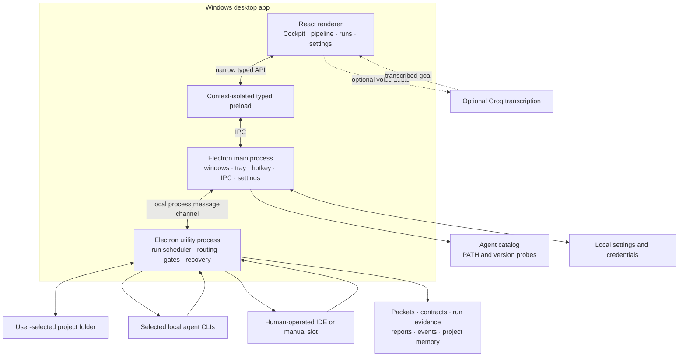
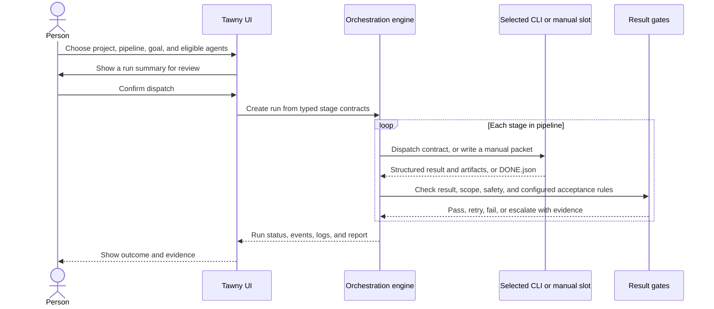

# Tawny Orch

> A Windows desktop orchestration prototype for routing work through locally installed coding-agent CLIs, collecting their outputs, and checking each handoff.

Tawny Orch is built with Electron, React, and TypeScript. The orchestration engine runs in an Electron utility process, separate from the UI renderer. Project files, run artifacts, packets, and logs are kept locally. This checkout does **not** include the planned phone app, remote relay, account service, or cloud control plane.

## At a glance

| | Current behavior |
| --- | --- |
| Platform | Windows desktop app; `pnpm dev` opens Electron |
| Workflow | Staged project pipeline with agent routing, handoff artifacts, gates, retries, and escalation |
| Agent access | Selected local CLIs plus a human operated manual packet slot |
| Default budget | Free-only routing with a `$0` paid dispatch budget |
| Storage | Local project and app data; JSON and JSONL files in the current implementation |
| Mobile | Not implemented; no phone pairing or remote connection endpoint |

This is a substantial desktop prototype, not the full multi-phase product in the architecture document. The status tables below record what the source supports today and what remains planned.

## Start the desktop app

### Requirements

- Windows 10 or 11
- Node.js and pnpm
- Git on `PATH` for Git-based workspace and verification features
- Install and sign in to the agent CLIs you plan to use; Tawny Orch does not install them

### Install and run

```powershell
pnpm install
pnpm dev
```

`pnpm dev` starts the Vite renderer and Electron shell. It should open a **desktop Electron window**; it is not a web server to open on a phone. In the app, attach a project folder in Cockpit, inspect and save its pipeline, check agent access in Settings, enter a goal, and review the run before dispatch.

Typed goals work without a transcription provider. Optional voice capture requires a Groq API key, network access, microphone permission, and provider allowance. Voice audio is sent to Groq for transcription; it is not an offline path.

### Development checks

```powershell
pnpm typecheck
pnpm test
pnpm build
```

`pnpm test` covers contracts, detection, routing, adapters, persistence, IPC, and local Git workflows. Real Git workflow tests require Git on `PATH`. The desktop UI suite is opt-in/skipped by the default Vitest run, so a successful build or test run is not a substitute for opening the Electron app and inspecting the UI.

## Visual architecture



The utility process keeps orchestration separate from React rendering, but it still belongs to the Electron app. It is **not** a standalone service that stays alive after the desktop app exits. The preload exposes a narrow typed API; renderer Node integration is disabled and context isolation is enabled.

### Data and handoff flow



Agents do not send arbitrary shell commands directly to each other. The engine records a stage result and builds a new contract for the next independently routed invocation, including relevant prior outputs and artifacts. Manual stages produce a Markdown packet for a person to use in an IDE or other tool; the person returns a `DONE.json` sentinel and evidence. The engine decides whether a stage can advance after applying its gates.

## Agent detection and support

Detection is deliberately narrower than “find every agentic terminal.” The catalog checks selected command names on `PATH` and probes their version. A detected badge means the local command was found and its version probe succeeded. It does **not** mean the tool is signed in, the current model has free access, quota remains, or a run will succeed.

| Agent | Command | Current integration |
| --- | --- | --- |
| Claude Code | `claude` | Headless adapter |
| Codex CLI | `codex` | Headless adapter |
| Gemini CLI | `gemini` | Headless adapter |
| Antigravity CLI | `agy` | Headless adapter; Antigravity IDE-only presence is not controlled |
| Cursor Agent | `cursor-agent` | Headless adapter |
| OpenCode | `opencode` | Headless adapter; Windows npm `.cmd` shims are supported |
| Muse Code | `muse` | Manual packet slot; public headless CLI support is not assumed |
| Qwen Code | `qwen` | Catalog/version probe; no automatic adapter in this build |
| Manual slot | — | Always available for person-completed stages |

On Windows, command probing and execution account for `PATHEXT` and `.cmd`/`.bat` shims. This is needed for npm-installed tools such as OpenCode. Agent-specific command arguments and output parsing live in their adapters. Detection is read-only: it does not install agents, log in, or inspect vendor quota APIs.

### If OpenCode says “Probe failed”

The current detection path must both locate `opencode` with `where.exe` and get a version string from `opencode --version`. The Windows shim resolver used by task dispatch is also used for version probes. A transient failed probe can still be shown until the next forced detection or the short detection cache expires.

1. Open a PowerShell window and run `where.exe opencode` and `opencode --version`.
2. If the version command works there, fully close and reopen Tawny Orch so Electron inherits the latest `PATH`.
3. In Tawny Orch, choose **Detect again**. If it still fails, record the command output and check the app's launch terminal for the underlying error.
4. Confirm the installed CLI is the one you intend to use; multiple `opencode` entries on `PATH` can select a different shim than expected.

This repository's current machine check returned OpenCode `1.18.35`, and the automated Windows-shim version probe passed. If your UI still says “Probe failed,” capture the exact current app state because that can indicate a different `PATH`, process environment, or older running build.

## How routing and safety work

- **Free-only default:** the router respects the configured `$0` paid dispatch budget and only treats free/local eligibility as available when the user confirms it in Settings. The app cannot guarantee third-party pricing.
- **Role and pin:** candidates are evaluated against the stage role and the user's saved/pinned choices.
- **Independent verification:** test/review routing can enforce a different agent family from the code author, where the workflow requires it.
- **Structured results:** adapters parse their supported output formats; agent self-reports alone are not treated as proof that work passed.
- **Gates:** the engine checks result shape and applicable scope, secret, Git/workspace, and configured acceptance checks.
- **Recovery:** failures can retry within configured limits or pause for human resolution. Interrupted work and evidence are retained for review.
- **Local processes:** headless CLI adapters spawn local child processes. The engine captures output and supports cancellation; it does not turn an IDE-only agent into a remotely controllable service.

Review acceptance commands before saving a pipeline. Those commands execute in the selected project.

## Mobile and remote access

**Mobile is not implemented in this checkout.** `pnpm dev` opens a local Electron desktop app, and the current utility process communicates with Electron over a local process channel. There is no HTTP/WebSocket endpoint, phone PWA, QR pairing, remote approval API, or outbound encrypted relay. A phone cannot connect securely to this local development build. The architecture document places PWA/relay work in a later phase; exposing a local port would not implement that security design.

## Architecture and implementation status

The product architecture describes a broader phased target. This table is an audit of this repository, not a claim of release readiness.

| Area | Implemented now | Still planned or incomplete |
| --- | --- | --- |
| Windows desktop | Electron shell, tray, hotkey, voice pill, dashboard, context-isolated preload | Production installer, code signing, public beta workflow |
| Engine process | Electron utility process and local process-message protocol | Standalone daemon, complete crash-survival and Windows Job Object guarantees |
| Projects and settings | Local project registry/settings; Electron `safeStorage` for credentials where available | Database-backed settings/state and full migration strategy |
| Voice and intent | Groq capture/transcription, local grammar, typed goals, review before dispatch | Local Whisper/VAD fallback and general LLM-backed compiler to the full architecture RunSpec |
| Discovery and drivers | Selected PATH/version probes, selected headless adapters, manual packet slots | ACP registry, general installer, WSL/IDE discovery, general PTY/ACP drivers, comprehensive auth/usage probes |
| Pipelines and verification | Staged engine, routing, retries/escalation, structured results, reports/events, configured acceptance checks | Broad contradiction detection and the complete target workflow/isolation guarantees |
| Memory | Local project JSONL ledger | SQLite/FTS5, embeddings, trust/decay scoring |
| Quota and failover | User-confirmed free/local eligibility, budget controls, bounded failover behavior | Signed live quota catalog and complete vendor usage telemetry |
| Mobile/cloud | None | PWA, pairing, encrypted relay, phone approvals, D1/R2, accounts and billing |

### Roadmap checkpoint

| Target phase | Repository audit |
| --- | --- |
| Week 1 — utility process, protocol, SQLite, close survival | **Partial:** utility process and protocol coverage exist; storage remains JSON, engine still depends on Electron |
| Week 2 — voice to confirmed RunSpec | **Partial:** typed/voice runs, project picker and review exist; no general RunSpec compiler or active-window resolver |
| Week 3 — headless drivers and routing | **Implemented for the current supported catalog:** selected adapters and probes exist; auth/free access remain user-confirmed; Muse Code is manual |
| Week 4 — planning, execution and isolated handoffs | **Partial:** engine, contracts, packets, retries and Git worktree support exist; full isolation guarantees do not |
| Week 5 — gates and independent verification | **Partial:** structured result, safety/scope checks, configured acceptance and family constraints exist; broad contradiction system does not |
| Week 6 — user demo gate | **Not evidenced:** no demo/interview results are checked into this repository |
| Week 7 — install flow and WSL | **Not implemented** |
| Week 8 — signed quota data and full failover | **Partial:** local eligibility and bounded failover exist; no signed live quota feed |
| Week 9 — advanced shared memory | **Partial:** local JSONL memory exists; SQLite search, embeddings and trust scoring do not |
| Week 10 — relay, PWA and phone approvals | **Not implemented** |
| Week 11 — accounts and billing | **Not implemented** |
| Week 12 — signed release and public beta | **Not implemented** |

## Data locations and repository map

- Project runtime data lives in `.tawny-orch/` under the selected project. It includes project configuration, packets, and project memory; it is ignored by Git.
- Electron user data holds app preferences, run state, logs, and credentials according to the local implementation. Credentials use Electron `safeStorage` where supported.
- Run reports and transcripts can contain project details. Review them before sharing.

| Path | Responsibility |
| --- | --- |
| `src/shared/` | Shared TypeScript and Zod contracts |
| `src/main/` | Electron lifecycle, IPC, detection, adapters, providers, engine, and utility process |
| `src/renderer/` | React desktop UI and styles |
| `test/` | Unit, integration, routing, detection, and local Git workflow tests |
| `PLAN.md` | Earlier product plan and implementation notes; roadmap items are targets, not proof of completion |

## Troubleshooting

| Symptom | Checks |
| --- | --- |
| White Electron window | Check the `pnpm dev` terminal for renderer errors, open Electron DevTools, then try `pnpm build`. Build success confirms compilation only; it does not prove the running window loaded correctly. |
| Agent says “Not detected” | Run `where.exe <command>` in PowerShell, confirm the CLI is on `PATH`, then restart Tawny Orch and use **Detect again**. |
| Agent says “Probe failed” | Run `<command> --version`; the executable may resolve while its version command fails, times out, or returns no version-like text. |
| Goal cannot dispatch automatically | Check the saved pipeline assignment and Settings eligibility. Detection does not confirm sign-in, price, or quota. |
| Voice capture unavailable | Check Groq configuration, network, microphone access, and provider allowance; type a goal to run without transcription. |
| Want to connect a phone | Mobile/relay is not implemented. Do not expose the local dev server as a substitute for the planned authenticated relay. |

## Design references

The interface uses a persistent compact shell, visible workflow state, and evidence-oriented run views. Product-specific choices include a sequential handoff rail, slate/blue/teal tokens, and Windows-friendly typography. External visual references consulted during the UI audit include [Mobbin](https://mobbin.com/), [Awwwards](https://www.awwwards.com/sites/real-ticket), [Godly](https://godly.website/), and [Land-book](https://land-book.com/sections/stats).
